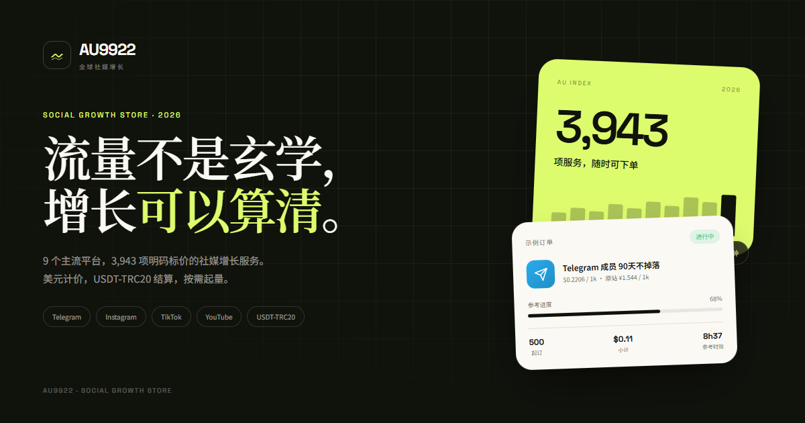

# AU9922 全球社媒增长

线上地址：<https://tidesmm.kalichen80.workers.dev>

客服 Telegram：[@Au9922](https://t.me/Au9922)

一个面向中文用户的社交媒体增长服务商城。以 [smm-x.com](https://smm-x.com/) 的公开服务目录为对标基准，重新设计了品牌、界面、文案与代码；当前上架 **3,943 项服务、9 个平台、8 类服务场景**，价格、起订量和参考时效均来自对标站点的公开价格表快照（2026-10-30）。

站点同时提供中文商城体验与 Cloudflare Workers 部署配置。前端是 React SPA，Worker 负责静态资源、API 健康检查与订单通知。



## 功能

- **完整服务目录**：3,943 项服务，可按平台、服务类型、关键词筛选与排序。
- **商品详情与价格计算**：按 1k / 整包两种计价方式，自动校验起订量与上限。
- **购物车**：本地持久化、数量调整、目标链接填写、金额实时计算。
- **结算流程**：联系方式、USDT-TRC20 收款地址、备注、服务条款确认；订单编号与进度页。
- **订单记录**：订单写入 Cloudflare D1，同时在本机保留一份；支持重新复制订单信息、查看收款地址、联系客服。
- **订单后台**：`/admin` 输入 `ADMIN_TOKEN` 可查看订单、联系方式、服务明细与 Telegram 通知状态。
- **搜索**：全站快捷搜索（`Ctrl/⌘ + K` 或 `/`），键盘上下选择。
- **响应式设计**：桌面、平板、手机；支持减少动态效果的系统偏好。
- **Cloudflare Worker**：静态资源 + `/api/health` + `/api/orders` + `/api/admin/orders`。
- **D1 订单库**：订单持久化到 Cloudflare D1，刷新、换设备也能在后台查看（客户侧仍保留本机记录）。
- **Telegram 订单通知**（可选）：配置 Bot 后，新订单会实时发送给客服；未配置时订单仍会入库。
- **SEO**：标题、描述、Open Graph、JSON-LD、自动生成 sitemap（3,964 个 URL）。
- **安全**：不收集账号密码或验证码；Worker 为所有响应添加安全头。

## 价格与支付

- 对标价格表原始单位为人民币；构建时按 **1 USD = 7 CNY** 换算为美元（`CNY_PER_USD` 可覆盖）。
- 全站商品以美元（`$`）展示；**1 USD = 1 USDT**。
- 仅支持 **USDT-TRC20**：
  - 网络：TRC-20
  - 收款地址：`TVfJbW6i4ERnTbexfJZgRu3ect91ZyDBVX`
  - 客服：[@Au9922](https://t.me/Au9922)
- 提交订单后按页面金额转账，并把交易哈希（TxID）发送给客服核对。页面不直接扣款，也不收集银行卡信息。

## 技术栈

- React 19 + TypeScript + Vite 8
- Tailwind CSS 4
- React Router 7
- Cloudflare Workers（静态资源 + API）
- Wrangler 4
- Playwright Core（本地视觉/流程验收脚本）

## 快速开始

要求 Node.js 22+、pnpm 11+。

```bash
pnpm install
pnpm dev
```

打开 <http://127.0.0.1:5173>。

生产构建与 Worker 本地联调：

```bash
pnpm build
pnpm exec wrangler dev
```

打开 <http://127.0.0.1:8787>。本地 Worker 已绑定 D1；如需本地测试订单入库，先执行一次：

```bash
pnpm exec wrangler d1 execute tidesmm-orders --local --file=worker/schema.sql
```

未配置 Telegram 时，`/api/orders` 仍会把订单写入 D1，前端显示「已提交后台」。

## 部署到 Cloudflare

### 1. 登录

```bash
pnpm exec wrangler login
```

如果环境没有浏览器，也可以使用 API Token：

```bash
export CLOUDFLARE_API_TOKEN=...
export CLOUDFLARE_ACCOUNT_ID=...
```

### 2. 部署

```bash
pnpm deploy
```

这会执行 `pnpm build`（含 SEO 生成），然后运行 `wrangler deploy`。当前线上地址：

```text
https://tidesmm.kalichen80.workers.dev
```

项目名在 [wrangler.jsonc](wrangler.jsonc) 的 `name` 字段。若名称被占用，改成自己的项目名即可；自定义域名可在 Cloudflare Dashboard → Workers → 对应 Worker → Settings → Domains & Routes 绑定。

### 3. 订单数据库

当前项目已在 Cloudflare 创建 D1 数据库 `tidesmm-orders`，并写入 [wrangler.jsonc](wrangler.jsonc) 的绑定。首次部署前对远程库执行一次建表：

```bash
pnpm exec wrangler d1 execute tidesmm-orders --remote --file=worker/schema.sql
```

如果把这个项目复制到另一个 Cloudflare 账号：

```bash
pnpm exec wrangler d1 create tidesmm-orders
# 把输出的 database_id 写入 wrangler.jsonc 的 d1_databases
pnpm exec wrangler d1 execute tidesmm-orders --remote --file=worker/schema.sql
```

### 4. 设置订单后台令牌

```bash
pnpm exec wrangler secret put ADMIN_TOKEN
```

输入一个足够长的随机字符串。之后访问：

```text
https://<your-worker-domain>/admin
```

输入同一个令牌即可查看订单、联系方式、服务明细与 Telegram 通知状态。令牌只保存在浏览器当前标签页的 `sessionStorage`，页面不会被搜索引擎索引。

### 5. 可选：开启 Telegram 订单通知

未配置时，订单仍会写入 D1，结算页显示「已提交后台」；配置后会额外推送一条消息到 Telegram：

1. 在 Telegram 找 `@BotFather` 创建机器人，拿到 Bot Token。
2. 给机器人发送一条消息，然后访问 `https://api.telegram.org/bot<token>/getUpdates` 找到 `chat.id`（也可以把机器人拉进群，使用群 ID）。
3. 写入 Worker Secrets：

```bash
pnpm exec wrangler secret put TELEGRAM_BOT_TOKEN
pnpm exec wrangler secret put TELEGRAM_CHAT_ID
```

4. 刷新站点。`/api/health` 会返回 `{"orderChannel":"telegram"}`，结算页显示「订单会实时发送给客服」。

本地联调可以用 `.dev.vars`（参考 [.dev.vars.example](.dev.vars.example)）或：

```bash
pnpm exec wrangler dev \
  --var TELEGRAM_BOT_TOKEN:test \
  --var TELEGRAM_CHAT_ID:123456
```

`TELEGRAM_API_BASE` 仅用于测试，可指向本地 mock 服务；生产环境不要设置。

## 自动部署（Cloudflare Git 集成）

当前仓库已与 Cloudflare 完成 GitHub 授权，项目类型已确认为 **Workers**（不是纯静态 Pages）。把代码推送到 `main` 后，Cloudflare 会按项目配置自动拉取、构建并部署。

Workers Builds 配置：

- Build command：`pnpm build`
- Deploy command：`pnpm exec wrangler deploy`
- Root directory：仓库根目录
- D1 绑定沿用 [wrangler.jsonc](wrangler.jsonc) 中的配置

本地手动部署仍然可以：

```bash
pnpm deploy
```

Telegram 与 ADMIN_TOKEN 是 Worker 的运行期 Secret，不进入 GitHub；在 Cloudflare Dashboard 或 `wrangler secret put` 配置一次后持续生效。

## 目录结构

```text
.
├─ src/
│  ├─ pages/            # 首页、目录、详情、购物车、结算、订单、后台、FAQ、法律页
│  ├─ components/       # 布局、导航、商品卡、购物车抽屉、搜索、Toast
│  ├─ lib/              # 目录索引、价格计算、本地订单、API 客户端
│  ├─ content/          # FAQ 文案
│  ├─ config.ts         # 品牌、联系方式、支付方式
│  └─ data/catalog.json # 构建后的商品目录
├─ data/
│  └─ catalog.source.json # 公开价格表快照（3,943 项，已剔除补差价条目）
├─ worker/
│  ├─ index.ts          # Worker：静态资源、订单、后台、通知
│  └─ schema.sql        # D1 订单表
├─ scripts/
│  ├─ build-catalog.mjs # 快照 → 商城目录
│  ├─ build-seo.mjs     # sitemap.xml + robots.txt
│  ├─ build-og.mjs      # Open Graph 图片
│  └─ qa.mjs            # Playwright 全流程验收
├─ wrangler.jsonc
└─ package.json
```

## 商品目录

商品来源是对标站点的公开「服务价格」表。快照保存在 `data/catalog.source.json`，构建脚本会：

- 统一平台名称（Telegram、Instagram、TikTok、YouTube、X / Twitter、Facebook、WhatsApp、Discord、LinkedIn、Threads）；
- 推导服务场景（成员/关注、浏览/播放、点赞/表情、评论、分享/转发、直播/空间、助力/加速、其他）；
- 根据起订与上限判断「每 1k」或「整包」计价；
- 生成搜索索引、精选服务与平台统计。

重新生成：

```bash
pnpm catalog
```

商品名称、价格、参考时效来自对标站点公开页面，仅作为目录数据使用；本项目的品牌、视觉、文案和代码为独立实现，未复制对方页面素材或营销文案。上架前请自行核对供应能力、价格与合规性。

## 上线前检查清单

- [ ] 替换 `src/config.ts` 中的品牌名、Telegram 客服地址与 USDT 收款地址。
- [ ] 修改 `wrangler.jsonc` 的 `name`，并更新 `index.html`、`scripts/build-seo.mjs` 中的站点 URL（或构建时设置 `SITE_URL`）。
- [ ] 配置 Telegram Bot（推荐），并设置 `ADMIN_TOKEN`。
- [ ] 确认 D1 远程表已创建，且 `/admin` 能登录查看订单。
- [ ] 核对 USDT-TRC20 收款地址、汇率换算与订单金额；当前为人工核对到账。
- [ ] 让专业人士审核 `服务条款`、`隐私政策`，补充经营主体信息。
- [ ] 确认商品目录、价格与目标平台规则的合规性。
- [ ] 为 `/api/orders` 配置 Cloudflare Rate Limiting 或 WAF 规则（公开接口，当前没有验证码）。
- [ ] 在 Worker 中设置自定义域名并检查 HTTPS。

## 当前边界

首版聚焦「目录 + 购物车 + 订单请求 + 后台查看」：

- 未接入自动到账/链上监听，USDT-TRC20 转账由客服人工核对；
- 未接入会员登录、余额系统与自助 API；
- 订单会写入 Cloudflare D1；未配置 Telegram 时不会主动推送，需要店主在 `/admin` 查看并跟进；
- 客户侧订单记录仍保存在浏览器，作为快捷入口；后台以 D1 数据为准；
- 商品价格来自人民币快照并按固定汇率换算为美元，实际结算前由客服确认。

这些边界都已在页面文案中明确说明，避免让客户误以为订单已经自动支付或自动进入交付。

## 验收

```bash
pnpm check      # 应用与 Worker 类型检查
pnpm build      # 生产构建
node scripts/qa.mjs
```

`qa.mjs` 使用系统 Chrome（`C:\Program Files\Google\Chrome\Application\chrome.exe`）跑通首页 → 目录筛选 → 搜索 → 详情 → 加购 → 结算 → 订单页，并输出桌面/移动端截图。其他平台请修改脚本中的 Chrome 路径。

## 说明

本项目与 Telegram、Meta、TikTok、YouTube、X 等平台没有隶属关系。所有平台名称与商标归其各自所有者。社交媒体增长服务可能受到目标平台服务条款或当地法律限制，运营方应自行评估并承担合规责任。
